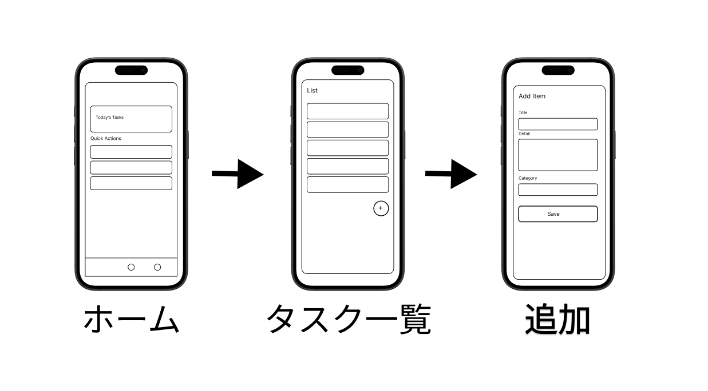

## {background-color="white" .center .break-slide}

::: {.break-title}
UI・UX
:::


## インターフェース（[Interface]{.en}）

**inter**（あいだ）+ **face**（面）= **界面**：2つのものが接する面

:::: {.columns}

::: {.column width="33%"}
::: {.fig-cite src="imgs/presentation/elevator_buttons.jpg" height="330px"}

::: {.cite}
Yoh-Plus, CC BY 4.0, Wikimedia Commons（トリミング）
:::

:::

::: {.caption-note .center}
人 ⇔ エレベーター
:::
:::

::: {.column width="33%"}
::: {.fig-cite src="imgs/presentation/light_switch.jpg" height="330px"}

::: {.cite}
Santeri Viinamäki, CC BY-SA 4.0, Wikimedia Commons
:::

:::

::: {.caption-note .center}
人 ⇔ 照明
:::
:::

::: {.column width="34%"}
::: {.fig-cite src="imgs/presentation/door_handle.jpg" height="330px"}

::: {.cite}
marya, CC BY 2.0, Wikimedia Commons
:::

:::

::: {.caption-note .center}
人 ⇔ ドア
:::
:::

::::


## UI（[**User Interface**]{.en}）

**UI**：人とコンピュータのインターフェース（[human–computer interface]{.en}）

:::: {.columns}

::: {.column width="40%"}
```{.d2 sketch="true" width="70%"}
direction: down
U: ユーザー {style.fill: "#e3f2fd"}
I: UI\n画面・ボタン\nキーボード・マウス {style.fill: "#fff3e0"}
C: コンピュータ {style.fill: "#e8f5e9"}
U <-> I
I <-> C
```
:::

::: {.column width="60%"}
::: {.fig-cite src="imgs/presentation/xerox_alto.jpg" height="380px"}

::: {.cite}
写真: Michael Hicks, CC BY 2.0, via Wikimedia Commons
:::

:::

::: {.caption-note .center}
Xerox Alto：画面・キーボード・マウスが UI
:::
:::

::::


## インタラクション（[Interaction]{.en}）

**inter**（あいだ）+ **action**（作用）= **相互作用**：操作と応答のやりとり

:::: {.columns}

::: {.column width="44%"}
```{.d2 sketch="true" width="100%"}
direction: right
U: ユーザー {style.fill: "#e3f2fd"}
C: コンピュータ {style.fill: "#e8f5e9"}
U -> C: 操作（入力）
C -> U: 応答（出力）
```

::: {.caption-note}
**HCI**（[**Human-Computer Interaction**]{.en}）：人とコンピュータのインタラクションを研究する分野
:::
:::

::: {.column width="56%"}
::: {.fig-cite src="imgs/presentation/first_mouse.jpg" height="360px"}

::: {.cite}
写真: Kazuhisa OTSUBO, CC BY 2.0, via Wikimedia Commons
:::

:::

::: {.caption-note .center}
最初のマウス（1964年、エンゲルバート考案）
:::
:::

::::


## UX（[**User Experience**]{.en}）

```{.d2 sketch="true" width="88%"}
direction: right
UX: UX（ユーザーの体験の全体） {
  style.fill: "#fafafa"
  A: 利用前\n知る・期待する {style.fill: "#fce4ec"}
  B: 利用中\nUI を通した\nインタラクション {style.fill: "#fff3e0"}
  C: 利用後\n達成感・また使いたい {style.fill: "#e8f5e9"}
  A -> B -> C
}
```

- UX という語は、1993年に Apple に入った認知科学者 **ドナルド・ノーマン**（Donald Norman）らが、部署名に使ったことで知られる（[Norman 2023](https://jnd.org/where-did-the-term-user-experience-ux-come-from/)）


## UI・ユーザビリティ・UX の定義

| 用語 | 定義 | 課題管理アプリでの例 |
|---|------|----|
| **UI**（[**User Interface**]{.en}） | ユーザーがタスクを行うための情報と操作手段を提供する、システムのすべての構成要素 | 締め切り順の一覧、追加ボタン |
| **ユーザビリティ**（[usability]{.en}） | 特定のユーザーが、特定の利用状況で、**効果**（[effectiveness]{.en}）・**効率**（[efficiency]{.en}）・**満足**（[satisfaction]{.en}）を伴って目標を達成できる度合い | 課題を誤りなく、少ない操作で登録できるか |
| **UX**（[**User Experience**]{.en}） | システム・製品・サービスの利用前・利用中・利用後に生じる、ユーザーの知覚と反応 | 使う前の期待、締め切りに間に合ったときの達成感 |

::: {.caption-note}
定義：[ISO 9241-210:2019](https://www.iso.org/standard/77520.html)（国内規格は JIS Z 8530:2021）
:::


## 人間中心設計（[**HCD**: Human-Centred Design]{.en}）

- システムの使われ方に着目し、人間工学とユーザビリティの知識・技法を適用して、システムを使いやすくする設計・開発の進め方

| 活動 | 明らかにすること | 成果物の例 |
|-----|----|---|
| **利用状況の理解及び明示**<br>[Understand and specify the context of use]{.en} | 誰が、どんな状況で、何のために使うか | ペルソナ |
| **ユーザー要求事項の明示**<br>[Specify the user requirements]{.en} | ユーザーが必要とすること | ユーザーストーリー |
| **設計解の作成**<br>[Produce design solutions]{.en} | 要求事項を満たす設計 | ワイヤーフレーム、プロトタイプ |
| **設計の評価**<br>[Evaluate the design]{.en} | 設計が要求事項を満たしているか | ユーザビリティテストの報告 |

::: {.caption-note}
評価で要求事項を満たさない点が見つかれば、必要な活動に戻る（[ISO 9241-210:2019](https://www.iso.org/standard/77520.html)）
:::


## ペルソナ（[Persona]{.en}）

- 調査データにもとづいて作る、対象ユーザーを代表する **架空の人物**
- **アラン・クーパー**（Alan Cooper）が、設計の手法として広めた
   - ペルソナの **ゴール**（[goal]{.en}）から、利用の場面を組み立てる
   - ユーザー像があいまいだと、設計者は自分に似た人を想定しやすい

| 項目 | 課題管理アプリのペルソナの例 |
|--|--------|
| 名前 | 佐藤 葵 |
| 属性 | 3年生、バスケットボール部 |
| 利用状況 | 帰宅は20時過ぎ。課題は帰りの電車でスマホから確認する |
| ゴール | すべての課題を締め切りまでに提出する |
| 困りごと | 締め切りの連絡が科目ごとに別の手段で届き、見落とす |

::: {.caption-note}
出典：Cooper *The Inmates Are Running the Asylum*（1999）、[Pruitt & Grudin 2003](https://www.microsoft.com/en-us/research/publication/personas-practice-theory/)
:::


## ユーザーストーリー（[User Story]{.en}） {#user-story}

- ユーザーの立場から、要求事項を短い文で書いたもの
   - 開発手法 **XP**（[Extreme Programming]{.en}）で使われはじめた
- 下の書式は、2001年に英国の Connextra 社で考案（[Agile Alliance](https://agilealliance.org/glossary/role-feature/)）

| 要素 | 書式 | 日本語での書き方 | 例 |
|--|----|----|-------|
| **役割** | [As a (role),]{.en} | 〈誰〉として | 部活で帰りが遅い学生として |
| **機能** | [I want (feature),]{.en} | 〈何〉をしたい | 締め切りの近い課題をすぐに確認したい |
| **理由** | [so that (reason).]{.en} | 〈なぜ〉だからだ | 提出を忘れたくないからだ |

::: {.caption-note}
役割には、ペルソナの属性と利用状況を当てる
:::

::: {.callout-note title="機能だけを書いた要求との違い"}
「課題を締め切り順に並べる」には、誰が・なぜ使うのかが書かれていない
:::


## **例** ユーザーストーリーで設計を評価する

:::: {.columns}

::: {.column width="48%"}
「部活で帰りが遅い学生として、締め切りの近い課題をすぐに確認したい。提出を忘れたくないからだ」

| 要求事項 | 右の3画面の評価 |
|---|-----|
| すぐに確認できる | ○ ホームに課題の欄（Today's Tasks）がある |
| 締め切りの近い課題が分かる | × 追加の画面に締め切りの入力欄がない |

::: {.callout-important title="結果"}
追加の画面に締め切りの入力欄を足す（設計解の作成に戻る）
:::
:::

::: {.column width="52%"}
::: {.fig width="100%"}

:::

::: {.caption-note .center}
追加の入力欄：Title・Detail・Category
:::
:::

::::


## {background-color="white" .center .break-slide}

::: {.break-title}
テンプレート
:::


## 6枚の構成

- チームで作ってきたアプリ案を、**6枚のスライド** で発表する
- 前半3枚で課題・目的・機能を説明する
- 後半3枚で画面の流れ・工夫・今後の方針を説明する

```{.d2 sketch="true" width="55%"}
grid-rows: 2
grid-columns: 3
1: ①課題\n何に困って\nいるか {style.fill: "#fce4ec"}
2: ②コンセプト\n何が良く\nなるか {style.fill: "#fff3e0"}
3: ③機能\n何が\nできるか {style.fill: "#e8f5e9"}
4: ④画面フロー\nどう\n流れるか {style.fill: "#e3f2fd"}
5: ⑤画面紹介\nどこを\n工夫したか {style.fill: "#ede7f6"}
6: ⑥まとめ\n価値と\n次の一手 {style.fill: "#f0f4c3"}
```


## テンプレート（前半）

| | スライド | 入れる項目 |
|-|-----|------------|
| ① | **課題**<br>[Problem]{.en} | ペルソナ（誰が・どんな状況で）<br>学生生活で不便なこと<br>このアプリを作ろうと思った理由<br>ユーザーの声（身近な人でも可。仮の例は仮と明記） |
| ② | **目的・コンセプト**<br>[Goal / Concept]{.en} | このアプリで何が良くなるか<br>コンセプトを **一言で**<br>[ユーザーストーリー](#user-story)（役割・機能・理由） |
| ③ | **機能概要**<br>[Feature Overview]{.en} | メイン機能を箇条書きで<br>その機能がどう役立つか |

::: {.callout-tip title="①〜③の対応"}
①のペルソナの困りごとに、②のユーザーストーリーと③の機能を対応させる
:::


## テンプレート（後半）

| | スライド | 入れる項目 |
|-|-----|------------|
| ④ | **画面フロー**<br>[User Flow]{.en} | ワイヤーフレームの画面をフローで並べる<br>起動 → ホーム → 詳細 のようなUI上の流れ |
| ⑤ | **画面紹介**<br>[Main Screens]{.en} | ワイヤーフレームの画面を大きく表示<br>デザイン・UIの工夫点（色・アイコン・レイアウトの理由） |
| ⑥ | **まとめ・今後**<br>[Summary / Next Steps]{.en} | アプリの価値のまとめ<br>今後追加したい機能<br>チームの学び |

::: {.callout-note title="⑤の説明例"}
「次の操作が分かるように、登録ボタンを入力欄の下にまとめた」のように、配置とその理由を対応させる
:::


## {background-color="white" .center .break-slide}

::: {.break-title}
レギュレーション
:::


## スライドの形式

- タイトルスライドに **チーム名と全員の名前**（6枚には数えない）
- 内容はテンプレートに従う
   - 1枚に収まらないときは、**2枚以上に渡ってもよい**
- 各スライドの右下に **担当者名**
- **16:9 横**、文字は **最低 18pt**
- 各スライドに **図画を最低1つ**（イラスト・図・スクリーンショット）


## 役割分担と時間

- **役割分担**
   - 各自が担当スライドの作成と発表を行う
   - 6人チーム：1人1枚 ／ それ以外：1人最低1枚 + 残りは分担を決める
- **発表時間**
   - 最大 **6分**
   - 1人あたり **最低20秒** は話す
- スライドめくりは発表者のPCではなく **進行側のPC** で行う
   - 切り替えるタイミングで「次のスライドをお願いします」と伝える


## 提出

- 最終的に **PDF化して提出**（チーム名.pdf）

::: {.callout-warning title="提出前に確認"}
PDFにしてから、文字の大きさ・図の有無・担当者名を確認する
:::


## 評価基準

| 対象 | チェックされる観点 |
|----|------------|
| ① 課題 | 課題設定が妥当か。根拠を示しているか |
| ② コンセプト | 課題に対して妥当か。**実装可能か** |
| ③ 機能 | コンセプトを実現できているか。実現可能か |
| ④ 画面フロー | 流れは妥当か。**明らかな抜け** はないか（例：ログインが必須の設計なのにログイン画面がない） |
| ⑤ 画面紹介 | 工夫がなされているか。その工夫は妥当と思わせられるか |
| ⑥ まとめ | 価値のまとめと今後の方向は妥当か |

::: {.caption-note}
課題・目的・機能・画面の説明がつながっているかを確認する
:::


## 発表のコツ

- 各スライドで最も伝えたいことを先に述べる
- 説明している画面やボタンを図で示す
- 担当者が交代する箇所のつなぎ方を決める
- 通し練習で、6分以内に収まるか、各自20秒以上話しているかを確認する

::: {.callout-note title="発表後の見直し"}
受けた質問を記録し、説明が不足していた点と、設計・実装を変える必要がある点を整理する
:::
