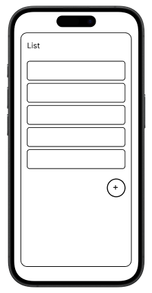
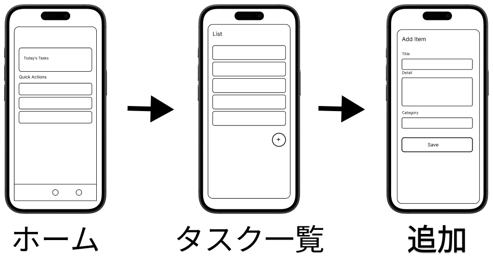
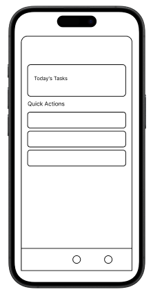

## {background-color="white" .center .break-slide}

::: {.break-title}
テンプレート
:::


## 6枚の構成

- チームで作ってきたアプリ案を、**6枚のスライド** で発表する
- 前半3枚で課題・目的・機能を説明する
- 後半3枚で画面の流れ・工夫・今後の方針を説明する

```{.d2 sketch="true" width="55%"}
grid-rows: 2
grid-columns: 3
1: ①課題\n何に困って\nいるか {style.fill: "#fce4ec"}
2: ②コンセプト\n何が良く\nなるか {style.fill: "#fff3e0"}
3: ③機能\n何が\nできるか {style.fill: "#e8f5e9"}
4: ④画面フロー\nどう\n流れるか {style.fill: "#e3f2fd"}
5: ⑤画面紹介\nどこを\n工夫したか {style.fill: "#ede7f6"}
6: ⑥まとめ\n価値と\n次の一手 {style.fill: "#f0f4c3"}
```


## タイトルスライド

::::: {.columns}

:::: {.column width="62%"}
::: {.mini-slide .cover label="見本"}

::: {.mini-title}
しめきり帳
:::

課題の締め切りを見落とさないためのアプリ

チームA\
青木・井上・上田・遠藤・小川・加藤

:::
::::

:::: {.column width="38%"}
#### 入れる項目

- チーム名
- 全員の名前

::: {.caption-note}
タイトルスライドは6枚に数えない
:::
::::

:::::


## ① 課題（[Problem]{.en}）

::::: {.columns}

:::: {.column width="62%"}
::: {.mini-slide label="見本"}

::: {.mini-title}
課題
:::

::: {.mini-row}

::: {.mini-col}
- **ペルソナ**：佐藤 葵（3年生、バスケットボール部）
   - 帰宅は20時過ぎ
   - 課題は帰りの電車でスマホから確認する
- **不便なこと**：締め切りの連絡が、科目ごとに別の手段で届く
- **作ろうと思った理由**：チームの全員に、提出を忘れた経験がある
- **ユーザーの声**：「どの課題がいつまでか、まとめて見たい」（同級生）
:::

::: {.mini-fig}
[数学：口頭]{.mini-chip}
[英語：メール]{.mini-chip}
[物理：掲示]{.mini-chip}
↓
[見落とす]{.mini-chip .warn}
:::

:::

::: {.mini-foot}
担当：青木
:::

:::
::::

:::: {.column width="38%"}
#### 入れる項目

- [ペルソナ](ui-ux.qmd#peek-persona){.peek}（誰が・どんな状況で）
- 学生生活で不便なこと
- このアプリを作ろうと思った理由
- ユーザーの声（身近な人でも可。仮の例は仮と明記）
::::

:::::


## ② 目的・コンセプト（[Goal / Concept]{.en}）

::::: {.columns}

:::: {.column width="62%"}
::: {.mini-slide label="見本"}

::: {.mini-title}
目的・コンセプト
:::

::: {.mini-lead}
開けば、今日の課題が分かる
:::

::: {.mini-row}

::: {.mini-col}
- **良くなること**：連絡を探さなくても、抱えている課題を確認できる
- **ユーザーストーリー**：部活で帰りが遅い学生として、締め切りの近い課題をすぐに確認したい。提出を忘れたくないからだ
:::

::: {.mini-fig}
[口頭・メール・掲示]{.mini-chip}
↓
[しめきり帳]{.mini-chip .accent}
:::

:::

::: {.mini-foot}
担当：井上
:::

:::
::::

:::: {.column width="38%"}
#### 入れる項目

- このアプリで何が良くなるか
- コンセプトを **一言で**
- [ユーザーストーリー](ui-ux.qmd#peek-user-story){.peek}（役割・機能・理由）
::::

:::::


## ③ 機能概要（[Feature Overview]{.en}）

::::: {.columns}

:::: {.column width="62%"}
::: {.mini-slide label="見本"}

::: {.mini-title}
機能概要
:::

::: {.mini-row}

::: {.mini-col}
- **今日の課題をホームに表示**
   - 開いてすぐ確認できる
- **課題を一覧で表示**
   - 抱えている課題を見渡せる
- **課題を追加**
   - 連絡を受けたその場で登録できる
:::

::: {.mini-fig}
{height="66%"}
:::

:::

::: {.mini-foot}
担当：上田
:::

:::
::::

:::: {.column width="38%"}
#### 入れる項目

- メイン機能を箇条書きで
- その機能がどう役立つか

::: {.callout-tip title="①〜③の対応"}
①のペルソナの困りごとに、②のユーザーストーリーと③の機能を対応させる
:::
::::

:::::


## ④ 画面フロー（[User Flow]{.en}）

::::: {.columns}

:::: {.column width="62%"}
::: {.mini-slide label="見本"}

::: {.mini-title}
画面フロー
:::

::: {.mini-row}

::: {.mini-fig}
{height="52%"}
:::

::: {.mini-col}
- ホームのボタンから **タスク一覧** へ
- 一覧の ＋ から **追加** へ
- Save を押すと一覧に戻る
:::

:::

::: {.mini-foot}
担当：遠藤
:::

:::
::::

:::: {.column width="38%"}
#### 入れる項目

- ワイヤーフレームの画面をフローで並べる
- 起動 → ホーム → 詳細 のようなUI上の流れ
::::

:::::


## ⑤ 画面紹介（[Main Screens]{.en}）

::::: {.columns}

:::: {.column width="62%"}
::: {.mini-slide label="見本"}

::: {.mini-title}
画面紹介：ホーム
:::

::: {.mini-row}

::: {.mini-fig}
{height="66%"}
:::

::: {.mini-col}
- **今日の課題を最上部に配置**
   - 開いてすぐ目に入るようにした
- **よく使う操作を、今日の課題の下にボタンでまとめた**
   - 次の操作を探さなくて済むようにした
:::

:::

::: {.mini-foot}
担当：小川
:::

:::
::::

:::: {.column width="38%"}
#### 入れる項目

- ワイヤーフレームの画面を大きく表示
- デザイン・UIの工夫点（色・アイコン・レイアウトの理由）

::: {.callout-note title="⑤の説明例"}
「次の操作が分かるように、登録ボタンを入力欄の下にまとめた」のように、配置とその理由を対応させる
:::
::::

:::::


## ⑥ まとめ・今後（[Summary / Next Steps]{.en}）

::::: {.columns}

:::: {.column width="62%"}
::: {.mini-slide label="見本"}

::: {.mini-title}
まとめ・今後
:::

::: {.mini-row}

::: {.mini-col}
- **価値**：開けば、今日の課題と抱えている課題が分かる
- **チームの学び**：ユーザーストーリーで画面を確かめて、締め切りの入力欄がないことに気づいた
:::

::: {.mini-fig}
**今後追加したい機能**

[締め切りの入力欄]{.mini-chip}
↓
[締め切り順に並べ替え]{.mini-chip}
↓
[締め切り前日に通知]{.mini-chip}
:::

:::

::: {.mini-foot}
担当：加藤
:::

:::
::::

:::: {.column width="38%"}
#### 入れる項目

- アプリの価値のまとめ
- 今後追加したい機能
- チームの学び
::::

:::::


## {background-color="white" .center .break-slide}

::: {.break-title}
レギュレーション
:::


## スライドの形式

- タイトルスライドに **チーム名と全員の名前**（6枚には数えない）
- 内容はテンプレートに従う
   - 1枚に収まらないときは、**2枚以上に渡ってもよい**
- 各スライドの右下に **担当者名**
- **16:9 横**、文字は **最低 18pt**
- 各スライドに **図画を最低1つ**（イラスト・図・スクリーンショット）


## 役割分担と時間

- **役割分担**
   - 各自が担当スライドの作成と発表を行う
   - 6人チーム：1人1枚 ／ それ以外：1人最低1枚 + 残りは分担を決める
- **発表時間**
   - 最大 **6分**
   - 1人あたり **最低20秒** は話す
- スライドめくりは発表者のPCではなく **進行側のPC** で行う
   - 切り替えるタイミングで「次のスライドをお願いします」と伝える


## 提出

- 最終的に **PDF化して提出**（チーム名.pdf）

::: {.callout-warning title="提出前に確認"}
PDFにしてから、文字の大きさ・図の有無・担当者名を確認する
:::


## 評価基準

| 対象 | チェックされる観点 |
|----|------------|
| ① 課題 | 課題設定が妥当か。根拠を示しているか |
| ② コンセプト | 課題に対して妥当か。**実装可能か** |
| ③ 機能 | コンセプトを実現できているか。実現可能か |
| ④ 画面フロー | 流れは妥当か。**明らかな抜け** はないか（例：ログインが必須の設計なのにログイン画面がない） |
| ⑤ 画面紹介 | 工夫がなされているか。その工夫は妥当と思わせられるか |
| ⑥ まとめ | 価値のまとめと今後の方向は妥当か |

::: {.caption-note}
課題・目的・機能・画面の説明がつながっているかを確認する
:::
