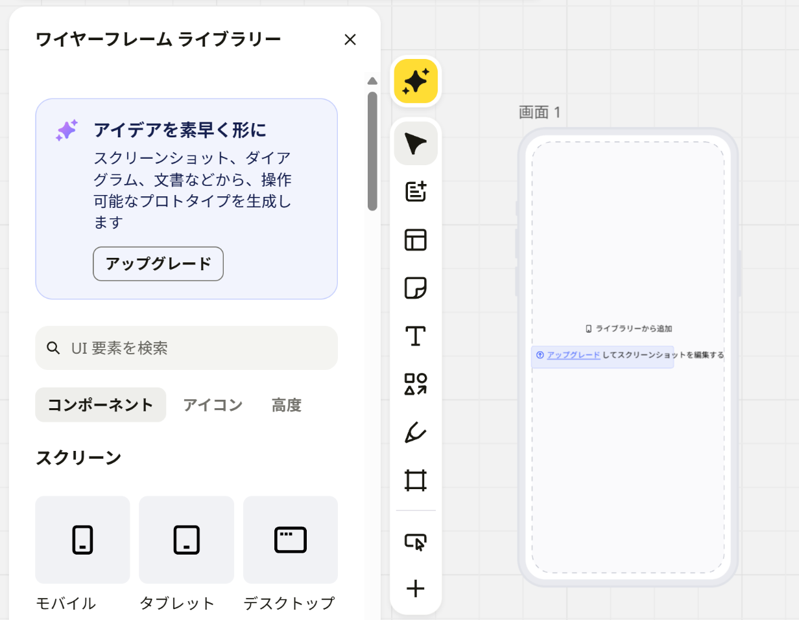
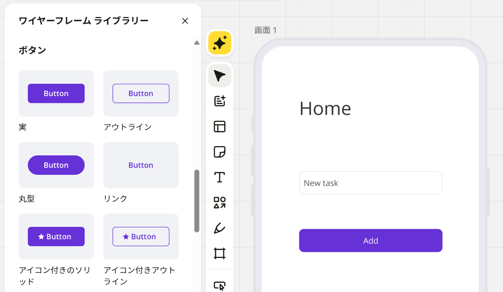
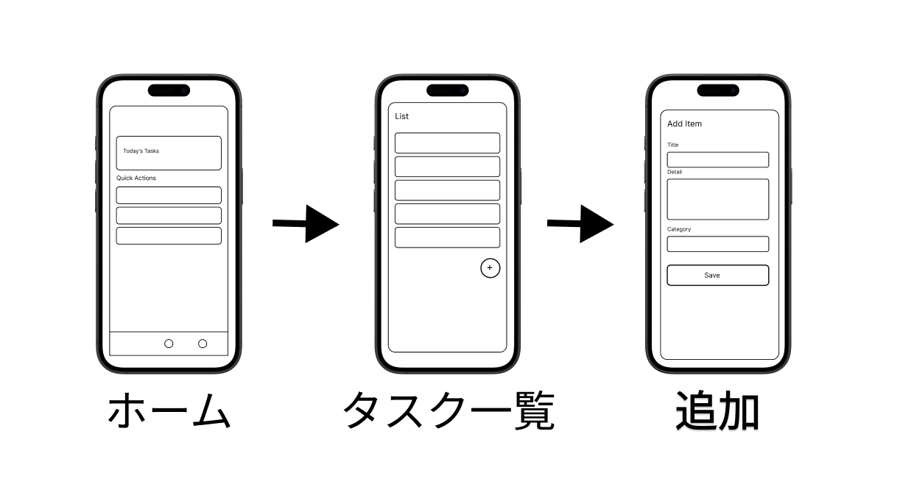
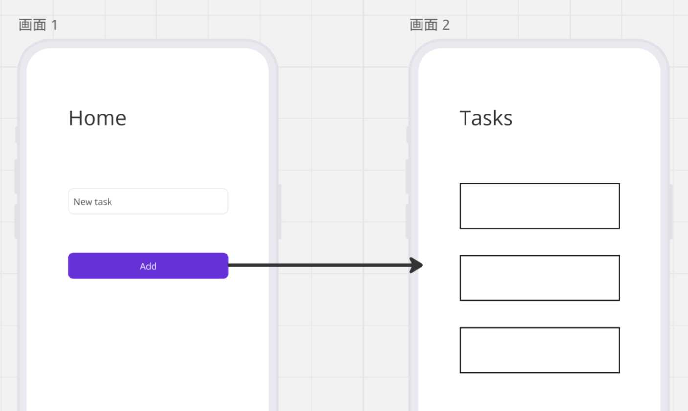

## {background-color="white" .center .break-slide}

::: {.break-title}
ワイヤーフレーム
:::

## **演習** 説明だけで画面を描く {.badge-practice}

::: {.prompt}
「今日の予定と、締め切りが近い課題を確認できるホーム画面」を、この説明だけを手がかりに紙に描け（30秒）。
:::

0. 紙とペンを用意
1. スマホの画面の枠を描き、その中に部品を配置
2. 隣の人の絵と比較（同じところ・違うところ）

::: {.callout-tip title="四角と文字で描く"}
絵のうまさは関係ない。部品は四角で描き、何の部品かを文字で書き添える
:::

## 同じ説明でも、描く画面は人によって違う

隣の人の絵と、次の点を比べてみましょう。

- 予定と課題の並べ方（上下に並べた？ タブで切り替えた？）
- 表示した課題の件数
- 締め切りの書き方（日付？ 「あと2日」のような残り日数？）
- 課題を追加するボタンの位置

::: {.callout-important title="要するに"}
文章で伝えた仕様は、読む人によって違う画面になる
:::

## ワイヤーフレームとは

**ワイヤーフレーム**（[wireframe]{.en}）は、線と箱だけで画面の構成を表した図。針金（wire）で組んだ骨組み（frame）のように、画面の構造を示す。

#### ワイヤーフレームで決めること

1. **何を**置くか：表示する情報・ボタン・入力欄
2. **どこに**置くか：配置と、目立たせる順番
3. **どこへ**移るか：ボタンを押したあとの画面

::: {.callout-note title="あとで決めること"}
色・フォント・写真・アイコンの細部
:::

## ワイヤーフレームは紙でも描ける

::: {.fig-cite src="imgs/wireframe/paper_wireframe.jpg" height="380px"}

::: {.cite}
写真: Intel Free Press, CC BY-SA 2.0, via Wikimedia Commons
:::

:::

::: {.caption-note}
紙とペンで画面を描いた例。デジタルのツールでは、複製・修正・共有がしやすい
:::

## 灰色の箱で描く理由

- 見た目の好みの話に流れない
   - 色や写真があると、「この青、ちょっと暗くない？」のような話が始まる
- 何を・どこに置くかの議論に集中できる
- 箱を動かすだけなので、描き直しが速い

::: {.callout-tip title="要するに"}
構成を先に決め、見た目はそのあとで決める
:::

## 変更は、早い段階ほど手間が少ない

#### 「ボタンの位置を変えたい」ときの作業

| 段階 | 必要な作業 |
|----|----|
| **ワイヤーフレーム** | 箱を動かす |
| **見た目まで作り込んだデザイン** | 色・余白・周りの部品との位置関係を直す |
| **実装したアプリ** | コードを書き換え、動作を確かめ直す |
| **公開したアプリ** | 修正版を配布し、利用者に変更を知らせる |

::: {.caption-note}
あとの段階ほど、1つの変更で直す場所が増える
:::

::: {.callout-important title="要するに"}
迷っている点は、ワイヤーフレームの段階で決めておく
:::

## 描くと、抜けに気づく

#### 「課題を追加できる」を画面にすると出てくる問い

- 追加したあと、どの画面に戻る？
- タイトルを空のまま保存したら、どうなる？
- 課題が1件もないとき、一覧には何を表示する？
- 追加をやめたいときは、どこを押す？

::: {.callout-tip title="要するに"}
画面を描くと、文章では決めていなかった動きに気づく
:::

## 立場が違っても、同じ図で話せる

| 立場 | ワイヤーフレームで確かめること |
|----|----|
| **UI/UXデザイナー** | 情報の優先度、操作の流れ |
| **エンジニア** | 必要な部品、画面ごとに必要なデータ |
| **PM**（プロダクトマネージャー） | 機能の範囲、仕様の抜け |
| **利用者** | 使い方が分かるか |

::: {.caption-note}
言葉だけで話すより、同じ図を指さしながら話すほうが、認識のずれに早く気づく
:::

## 部品は、コードの部品に対応する

ワイヤーフレームの部品は、[NiceGUI](nicegui.qmd)（Pythonだけで画面を作れるフレームワーク）の部品にほぼそのまま対応する。

| ワイヤーフレームの部品 | NiceGUIの部品 |
|----|----|
| 見出し・文字 | `ui.label` |
| ボタン | `ui.button` |
| 入力欄 | `ui.input` |
| カード（枠で囲んだまとまり） | `ui.card` |
| 縦に並べる／横に並べる | `ui.column` ／ `ui.row` |

::: {.callout-tip title="要するに"}
画面ごとに部品を書き出しておくと、実装で書くコードの見通しが立つ
:::

## {background-color="white" .center .break-slide}

::: {.break-title}
Miro
:::

## Miro：オンラインホワイトボード

- **Miro**（ミロ）は、ブラウザで使えるオンラインホワイトボード
   - 複数人で同じボードを同時に編集できる
- ワイヤーフレーム用の部品集 **ワイヤーフレーム ライブラリー** がある
   - スマホ・タブレット・PCの画面の枠
   - ボタン・入力欄・ナビゲーションバーなどの部品

::: {.callout-note title="無料プランのボード"}
編集できるのは直近の3枚まで。それより前のボードは、見ることはできるが編集できない
:::

## スマホの画面を置く

:::: {.columns}

::: {.column width="40%"}
1. ボード左のツールバーの **＋** をクリック
2. 検索欄に「Wireframing」と入力し、**ワイヤーフレーム ライブラリー** を開く
3. **モバイル** の画面をボードにドラッグ
:::

::: {.column width="60%"}
::: {.fig width="100%"}

:::
:::

::::

## 部品を画面に置く

:::: {.columns}

::: {.column width="40%"}
1. ワイヤーフレーム ライブラリーの部品（ボタン・入力欄など）を、スマホの画面の上にドラッグ
2. 部品の文字を、自分のアプリの内容に書き換え
:::

::: {.column width="60%"}
::: {.fig width="100%"}

:::
:::

::::

## 基本操作

| キー | 操作 |
|---|---|
| **T** | テキスト（タイトルやラベル） |
| **R** | 四角形（カードや仮のボタン） |
| **Alt + ドラッグ** | ドラッグした先に複製 |
| **Ctrl + D** | 選択した部品を複製 |
| **Space + ドラッグ** | ボードの表示位置を動かす |

::: {.caption-note}
Mac では Ctrl を ⌘ Command、Alt を ⌥ Option に読み替える
:::

## **演習** まず1画面作る {.badge-practice}

::: {.prompt}
「今日の予定を見る画面（Home）」を Miro で1画面作れ。
:::

0. Miro にログインし、新しいボードを作成
1. ワイヤーフレーム ライブラリーから **モバイル** の画面を配置
2. **T** で「Home」のタイトルを画面左上に配置
3. **R** の四角形でカード（Today's Tasks）
4. 四角を3つ並べてクイックメニュー（Quick Actions）

::: {.callout-tip title="部品の用途を示す"}
グレーの四角と黒い文字でよい。カードやメニューには、何を表示する場所か分かるラベルを付ける
:::

## 例：3画面のワイヤーフレーム

::: {.fig width="78%"}

:::

::: {.caption-note .center}
矢印は、ボタンを押したときの画面の移動を表す
:::

## 画面の移動を矢印で示す

:::: {.columns}

::: {.column width="40%"}
1. **L** キーで線（矢印）を選ぶ
2. 移動のきっかけになるボタンから、移動先の画面までドラッグ
:::

::: {.column width="60%"}
::: {.fig width="100%"}

:::
:::

::::

## **演習** 3画面のワイヤーフレーム {.badge-practice}

::: {.prompt}
ホーム → タスク一覧 → 追加フォーム の3画面ワイヤーフレームを作り、画面の移動を矢印で示せ（さっきの例の図を目安にすること）。
:::

0. モバイルの画面を横並びで3つ配置
1. **ホーム**：タイトル・カード・クイックメニュー・下タブ（◯3つ）を配置
2. **タスク一覧**：タイトル・リストアイテム5つ・右下の「＋」ボタンを配置
3. **追加フォーム**：Title・Detail・Category の入力欄と Save ボタンを配置
4. **L** の矢印で、ボタンと移動先の画面を接続

## よくある画面パターン

| 系統 | 定番の部品 |
|----|----|
| **ホーム系** | カード表示・サマリー情報・クイックリンク |
| **一覧系**（[List]{.en}） | タイトル + サブ情報、「＞」で詳細へ |
| **詳細系**（[Detail]{.en}） | タイトル・説明、編集／削除ボタン |
| **入力系**（[Form]{.en}） | テキスト欄・日付選択・Save / Cancel |
| **ナビゲーション系** | 下タブ（[Tab bar]{.en}）・ハンバーガーメニュー・操作用の丸ボタン（[FAB: Floating Action Button]{.en}） |

::: {.callout-tip title="手元のアプリと比較する"}
スマホのアプリを1つ開き、ホーム・一覧・詳細・入力のどの画面があるか確認する
:::

## **演習** 自分のアプリの画面を作る {.badge-practice}

::: {.prompt}
ペイオフマトリクスで「すぐやるべき」に選んだ自分のアプリ案について、3画面以上のワイヤーフレームを作り、画面の移動を矢印で示せ。
:::

0. 最初に作る画面を **3つ** 選定
1. 前ページのUIパターンから部品を選択
2. 各画面に配置
3. **L** の矢印で、ボタンと移動先の画面を接続
4. 矢印をたどり、戻る手段のない画面がないか確認

::: {.callout-important title="設計と実装"}
このワイヤーフレームを [最終課題](final-project.qmd) の設計に使う。[NiceGUI](nicegui.qmd) の部品で配置を作り、データの取得や入力処理を追加する
:::

## （参考）開発現場の画面設計ツール

- 開発の現場では、**Figma**（フィグマ）などの画面設計専用のツールも広く使われる
   - 部品の使い回し、実装に必要な寸法の確認、クリックで動く試作までを1つのツールで扱える
- Figma を個人で使えるのは、日本では18歳以上
   - 18歳未満は、学校が Figma と契約している場合に限り使える（2026年11月時点の規約）
